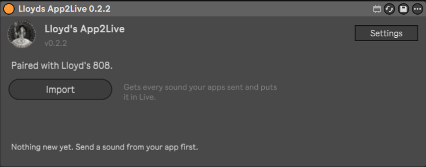
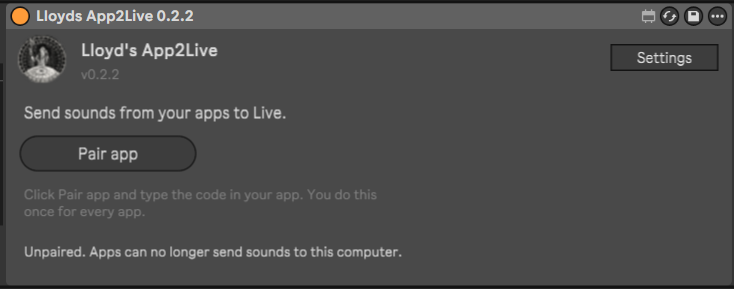
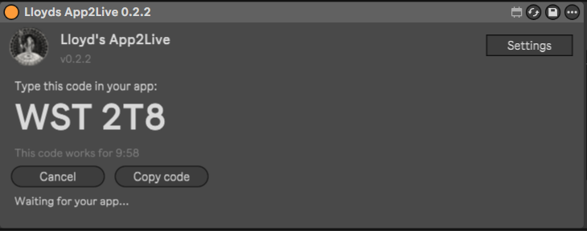
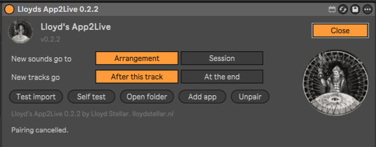

# Lloyd's App2Live (LA2L)

**Send sounds from your phone or web apps straight into Ableton Live.**

Lloyd's App2Live is a free, open source Max for Live device. Make a beat, a loop or a sample in an app, send it, and click **Import** in Live. Every sound lands on its own new audio track: named, coloured, and warped to the tempo the app made it in.



**[Download Lloyd's App2Live](https://lloydstellar.nl/la2l/lloyds-app2live.zip)** · Ableton Live 12.4 or newer with Max for Live · Windows and Mac

## How it works


1. **Your app** sends its sounds: WAV files, plus a short note per sound with its name, its tempo and whether it is a loop or a one-shot.
2. **The LA2L server** keeps them for you until you are ready, for up to 24 hours.
3. **In Live** you click **Import** in the LA2L device.
4. **Every sound becomes a new audio track.** Loops are warped to the app's tempo, one-shots play exactly as the app made them.

You pair an app only once, with a code the device shows. After that, the app can send to your computer whenever you like. Nothing reaches Live until you click Import.

## Install

You need Ableton Live 12.4 or newer with Max for Live: Live Suite, or Live Standard with the Max for Live add-on.

1. Download [lloyds-app2live.zip](https://lloydstellar.nl/la2l/lloyds-app2live.zip).
2. Unzip it. Inside is one file: `Lloyds App2Live.amxd`.
3. Put that file somewhere it can stay. Your User Library is a good place, for example `User Library/Presets/Audio Effects/Max Audio Effect`. Live's browser then shows it under **User Library**.
4. Drag **Lloyds App2Live** onto an audio track. The sound of the track passes through it unchanged.

A group track, a return track or the Main track works too. On a group track new tracks go to the top of that group; on a return or the Main track they go after all other tracks.

## Use it

### 1. Pair your app, once



Click **Pair app**. The device shows a code:



Type that code in your app. The code works for 10 minutes. Is the app in a browser on the same computer? Click **Copy code** and paste it.

When the app has the code, the device says **Paired with** and the name of the app. You do this once for every app.

### 2. Send a sound from your app

Make something in the app and send it to Live. The app's own button or menu says how, for example **Send to Live**.

### 3. Click Import

Click **Import**, the button you saw at the top of this page. The device gets everything your apps sent and puts every sound on a new audio track:

- In the **Arrangement**, the clips start at 1.1.1, wherever the playhead is.
- In the **Session**, every package gets its own new scene at the top.
- **Loops** are warped to the app's tempo. The warp mode fits the sound: Beats for drums, Tones for bass, Complex Pro for melodies and vocals.
- **One-shots** play exactly as the app made them: no warp, no loop.
- Did the app use another tempo than your Set? A button like **Use 92 BPM** appears. LA2L never changes the tempo of your Set by itself.

The sounds are saved with your Set, in its project folder under `Samples/LA2L`, so **Collect All and Save** works as usual. Sounds imported into a Set you have not saved yet wait in `Documents/Lloyds App2Live/Inbox`.

### No app yet? Try it

- **LA2L Sender** at [lloydstellar.nl/la2l](https://lloydstellar.nl/la2l/) is a web page that pairs like an app and sends WAV, mp3 or m4a files from your browser or phone. On Android, installed from Chrome, it also shows up in the share menu of other apps.
- **Web808** at [lloydstellar.nl/la2l/examples/drum-machine](https://lloydstellar.nl/la2l/examples/drum-machine/) is a small drum machine that sends its loops to Live.
- **Settings > Test import** puts a test loop in your Set without any app.

### Settings



| | |
|---|---|
| **New sounds go to** | **Arrangement** or **Session**. |
| **New tracks go** | **After this track** (the track the device is on) or **At the end**. |
| **Test import** | Places a test loop, to check that LA2L works in your Live. |
| **Self test** | Checks the connection with the server and the paired apps. |
| **Open folder** | Opens `Documents/Lloyds App2Live`: the settings, the log and the Inbox. |
| **Add app** | Pairs one more app with this computer. |
| **Unpair** | Disconnects all apps from this computer. Click it twice to be sure. |

LA2L keeps its settings per computer, in `Documents/Lloyds App2Live/settings.json`, not in your Set. The settings without a button can be changed there by hand. LA2L reads the file again at every click.

| Setting | Default | |
|---|---|---|
| `serverUrl` | `https://lloydstellar.nl/la2l/api` | The server. Only `https://`, except `http://localhost` for testing. |
| `appNameInTrackName` | `true` | "Kick (Web808)" instead of "Kick". |
| `testUrl` | a snare loop on lloydstellar.nl | The file Test import downloads. When it cannot, Test import uses a loop built into the device. |
| `testName`, `testBpm`, `testKind`, `testRole` | `Snare`, `135`, `loop`, `drums` | How Test import places that file. |

The same folder holds `la2l.log`, which says what the device did.

### Privacy

Your sounds pass through the LA2L server only to reach your Live; they are deleted after import, or after 24 hours. Read the [privacy statement](https://lloydstellar.nl/la2l/developers/privacy.html). You can also [run your own server](#run-your-own-server).

## For app developers

Want your app to send to Live? There is no API key and no developer account: the user pairs your app with the code LA2L shows, and that code is the consent.

```js
import { LA2L, wavFromAudioBuffer } from '@lloydstellar/la2l';

const la2l = new LA2L({ appName: 'Web808' });
if (!la2l.paired) await la2l.pair(codeFromUser); // the code LA2L shows, like "K7P 42Q"
await la2l.send({
  title: 'Treinbeat',
  bpm: 92,
  sounds: [{ name: 'Beat', audio: wavFromAudioBuffer(loopBuffer), kind: 'loop', role: 'drums' }],
});
```

| Your app | Use |
|---|---|
| A web app | `npm install @lloydstellar/la2l`, or the ready-made **Send to Live** button without a build step ([sdk/js](sdk/js/)) |
| An Android app | `nl.lloydstellar:la2l-ktx` (Kotlin) or `nl.lloydstellar:la2l` (Java) from `https://lloydstellar.nl/la2l/maven/` ([sdk/android](sdk/android/)), or share WAV files with LA2L Sender without any network code |
| A script, or any other language | `npx @lloydstellar/la2l send`, or five HTTPS calls ([docs/openapi.yaml](docs/openapi.yaml)) |
| Built with an AI coding tool | The skill in [skills/](skills/), or the paste text for Lovable and Bolt |

- **Start here:** the developer pages at [lloydstellar.nl/la2l/developers](https://lloydstellar.nl/la2l/developers/) (sources in [docs/developers/](docs/developers/)).
- **Test without Ableton:** the [test receiver](https://lloydstellar.nl/la2l/receiver) stands in for LA2L in Live, as a page, on the command line and in your own tests.
- **Examples:** [examples/](examples/) has the Web808 drum machine and two Android apps.
- **The package format:** [docs/manifest.md](docs/manifest.md) and [docs/app2live-1.schema.json](docs/app2live-1.schema.json).

## Run your own server

LA2L uses the server at `https://lloydstellar.nl/la2l/` by default. You can run `la2l-server` yourself: Node.js in one Docker container, no npm packages, behind a web server that does HTTPS.

- [server/README.md](server/README.md): install, settings, update, backup and restore.
- [docs/server-api.md](docs/server-api.md): the API between the apps, the server and the device.
- [server/BUILD-PROMPT.md](server/BUILD-PROMPT.md) and [sdk/BUILD-PROMPT.md](sdk/BUILD-PROMPT.md): the briefs the server and the developer kit were built from.

To point the device at your server, click **Settings > Open folder** and set `serverUrl` in `settings.json` to your server's address, for example `https://example.com/la2l/api`. The apps need the same address; the SDKs take it as an option.

## Work on the device

The device itself lives in this repository too. It needs only Node.js 18 or newer; there are no npm packages.

```
node tools/build.js      # builds devices/la2l
npm test                 # runs the device tests against a simulated Live and server
```

Restart Live after every build: Live keeps a loaded device in memory. Never save the device from the Max editor; `tools/gen-patch.js` generates the patch. The test to run in Live, with what you should see at every step, is [docs/test-card-en.md](docs/test-card-en.md).

| Path | |
|---|---|
| `src/node/` | The Node for Max part: server, downloads, WAV check, manifest, settings, and the controller `app.js`. |
| `src/live/la2l-live.js` | The Live part, a `[v8]` script: new tracks, clips, warp, loop, names, colours. |
| `tools/` | The patch generator and the build. |
| `tests/` | Tests with a simulated Live (`mock-live.js`) and a simulated server (`mock-server.js`). |
| `devices/la2l/` | The built device. |
| `server/` | The server and LA2L Sender. |
| `sdk/`, `examples/`, `skills/` | The developer kit. |
| `docs/` | The server API, the package format, the design notes and the test card. |

How the parts of the device fit together, and what real Live does through its API, is in [docs/design-notes.md](docs/design-notes.md).

## License

Apache License 2.0. See [LICENSE](LICENSE).
